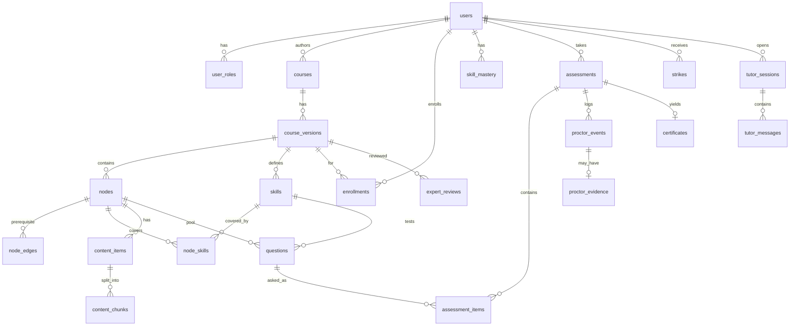

# EduForge — data model (PostgreSQL + pgvector)

This is the **logical** model: the source of truth about entities and relationships. Exact types and migrations are written by the agent within the milestones, but the structure must not be changed without an entry in `SPEC.md`. All `id` columns are `uuid` (default `gen_random_uuid()`); all time columns are `timestamptz`.

## 1. Relationship overview



## 2. Enums

| Enum | Values |
|---|---|
| `role` | `student`, `author`, `expert`, `admin` |
| `version_status` | `draft`, `auditing`, `changes_requested`, `ready_to_publish`, `expert_review`, `published`, `archived` |
| `content_kind` | `markdown`, `video` |
| `transcript_source` | `author`, `whisper` |
| `question_kind` | `mcq`, `short`, `open` |
| `question_pool` | `node`, `exam`, `assessment` |
| `question_status` | `generated`, `validated`, `rejected`, `retired` |
| `node_state` | `locked`, `available`, `in_progress`, `passed`, `cooldown` |
| `assessment_kind` | `node_test`, `exam`, `pretest`, `posttest`, `delayed_posttest` |
| `assessment_status` | `in_progress`, `submitted`, `passed`, `failed`, `interrupted`, `annulled` |
| `event_severity` | `info`, `soft`, `hard` |
| `strike_status` | `pending_review`, `confirmed`, `dismissed`, `appealed`, `overturned` |
| `review_status` | `assigned`, `approved`, `rejected` |
| `llm_purpose` | `question_generation`, `question_validation`, `audit_conformity`, `audit_skills`, `audit_scoring`, `open_grading`, `tutor`, `tutor_guard`, `recommendation`, `certificate_summary`, `vision_check`, `transcription`, `embedding` |

## 3. Users and access

```
users(id, email unique, password_hash, display_name, created_at, exam_ban_until null, exam_banned_forever bool default false)
user_roles(user_id → users, role, PK(user_id, role))
consents(id, user_id, kind, version, given_at)           -- kind: 'proctoring','research','terms'
```

## 4. Courses, graph, skills

```
courses(id, author_id → users, slug unique, created_at)

course_versions(
  id, course_id → courses, version_no, parent_version_id null → course_versions,
  title, description, declared_level,                  -- declared by the author
  status version_status, audit_attempts int default 0,
  rating smallint null check (rating between 1 and 10),
  ai_level text null, ai_hardness real null,           -- audit results
  volume_cap smallint null, audit_summary jsonb null,  -- per-category feedback for the author
  created_at, published_at null,
  UNIQUE(course_id, version_no)
)

skills(id, course_version_id → course_versions, name, description,
       verified bool null, verification_note null)

nodes(id, course_version_id, title, summary, position jsonb null)   -- position is for the graph editor

node_edges(prereq_node_id → nodes, node_id → nodes, PK(prereq_node_id, node_id),
           CHECK(prereq_node_id <> node_id))                        -- AND semantics; acyclicity is enforced by the application + checked on publication

node_skills(node_id → nodes, skill_id → skills, PK(node_id, skill_id))
```

Indexes: `nodes(course_version_id)`, `node_edges(node_id)`, `skills(course_version_id)`.
Acyclicity is checked in the service layer (Kahn's algorithm) and, in tests, also as a SQL query on a recursive CTE.

## 5. Content and RAG

```
content_items(id, node_id, kind content_kind, title, ord,
              body_md null,                                     -- for markdown
              video_url null, video_storage_key null,
              transcript_text null, transcript_source null)     -- for video, a transcript is mandatory at publication

content_chunks(id, node_id, content_item_id, chunk_index, text, token_count,
               embedding vector(<DIM>))                         -- <DIM> is determined by the chosen model (OQ-2)
```

Indexes: HNSW on `embedding` (cosine), btree on `node_id`. Tutor search always carries `node_id = ANY(:allowed_node_ids)`.

## 6. Question bank

```
questions(
  id, node_id, skill_id, pool question_pool, kind question_kind,
  prompt_md, options jsonb null,                         -- for mcq
  answer_key jsonb, rubric text null,                    -- never given to the tutor
  difficulty real, guess real, slip real default 0.10,
  status question_status, rejection_reason null,
  generator_run_id → llm_runs, validator_run_id → llm_runs null,
  created_by null → users, created_at
)

static_hints(id, node_id, question_id null, level smallint, text)   -- tutor fallback
```

Constraints: a `pool='exam'` question is not used in node tests; `pool='assessment'` is used only in the experiment.

## 7. Learning and assessment

```
enrollments(id, user_id, course_version_id, status, started_at, completed_at null, UNIQUE(user_id, course_version_id))

node_progress(user_id, node_id, state node_state, round_no int, attempts_in_round int,
              cooldown_until null, passed_at null, PK(user_id, node_id))

skill_mastery(user_id, skill_id, p_known real, n_obs int, updated_at, PK(user_id, skill_id))

mastery_history(id, user_id, skill_id, assessment_item_id, p_before real, p_after real, at)   -- append-only

assessments(
  id, user_id, kind assessment_kind, course_version_id, node_id null,
  round_no int, attempt_no int, status assessment_status,
  started_at, deadline_at, submitted_at null,
  score_pct real null, per_skill jsonb null,
  interruptions int default 0, risk_score real default 0,
  question_set_seed bigint, meta jsonb
)

assessment_items(
  id, assessment_id, question_id, ord,
  shown_at null, answered_at null, answer jsonb null,
  is_correct bool null, score real null,
  graded_by text null,                                -- 'auto' | 'llm'
  grader_run_id null → llm_runs, time_ms int null, hints_used int default 0
)
```

## 8. AI tutor

```
tutor_sessions(id, user_id, node_id, question_id null, created_at)
tutor_messages(id, session_id, role, content, hint_level smallint null,
               guard_verdict jsonb null, retrieved_chunk_ids uuid[] , llm_run_id null, created_at)
```

## 9. Audit and review

```
audit_runs(id, course_version_id, attempt_no, stage, status, result jsonb, created_at)  -- stage: structure|volume|conformity|skills|scoring
expert_reviews(id, course_version_id, expert_id → users, assigned_by → users,
               status review_status, checklist jsonb null, decided_at null, created_at)
notifications(id, user_id, type, payload jsonb, read_at null, created_at)
```

The raw audit responses (all N runs) live in `llm_runs`; `audit_runs.result` holds the aggregate.

## 10. Proctoring and strikes

```
proctor_events(id, assessment_id, ts, source, type, severity event_severity, payload jsonb)
  -- source: 'browser'|'frame'|'keystroke'|'server'

proctor_evidence(id, event_id → proctor_events, storage_key, sha256, expires_at)  -- only for events with a frame; deleted by the worker after expires_at or once the appeal is resolved

strikes(id, user_id, assessment_id, reason, status strike_status, level smallint,
        ban_until null, reviewed_by null → users, created_at, resolved_at null)
```

## 11. Certificates

```
signing_keys(kid pk, public_key, created_at, retired_at null)   -- the private key is never in the DB
certificates(id uuid pk,                                         -- also the certificate_id in the payload
             user_id, course_version_id, assessment_id,
             payload jsonb, payload_sha256, signature, kid → signing_keys,
             issued_at, revoked_at null, revoke_reason null)
```

Example `payload` (canonical JSON): `certificate_id`, `holder_name`, `course {id, version, title}`, `rating`, `score_pct`, `issued_at`, `skills [{name, level, pct}]`, `summary_text`, `kid`.

## 12. Recommendations, LLM, events

```
recommendations(id, user_id, day date, items jsonb, llm_run_id, created_at, UNIQUE(user_id, day))

llm_runs(id, purpose llm_purpose, model, params jsonb, prompt_version text, prompt_hash,
         request jsonb, response jsonb, tokens_in int, tokens_out int, cost_usd numeric,
         latency_ms int, subject_type null, subject_id null, created_at)

event_log(id bigserial, ts, user_id null, session_key null, name text, props jsonb)   -- research logging (RESEARCH.md)
```

## 13. Research (minimal tables)

```
experiment_participants(user_id pk, code text unique,      -- pseudonym for export
                        consent_at, order_variant text)     -- 'A_then_B' | 'B_then_A'
experiment_assignments(user_id, module text, condition text, period smallint, PK(user_id, module))
                        -- condition: 'method' | 'control'
```

Export for analysis goes only through the pseudonym `code`, without email or name.

## 14. Integrity rules and data retention

- Published `course_versions` and the related `nodes/skills/questions` are **immutable** (enforced at the service level and by tests).
- `mastery_history`, `event_log`, `llm_runs`, `proctor_events` are append-only.
- Retention worker: daily deletes `proctor_evidence` with `expires_at < now()` (and the files in storage).
- Deleting a user anonymizes personal fields. The policy for already-issued certificates (the payload contains the holder's name) is settled during M11 and recorded in the SPEC.
